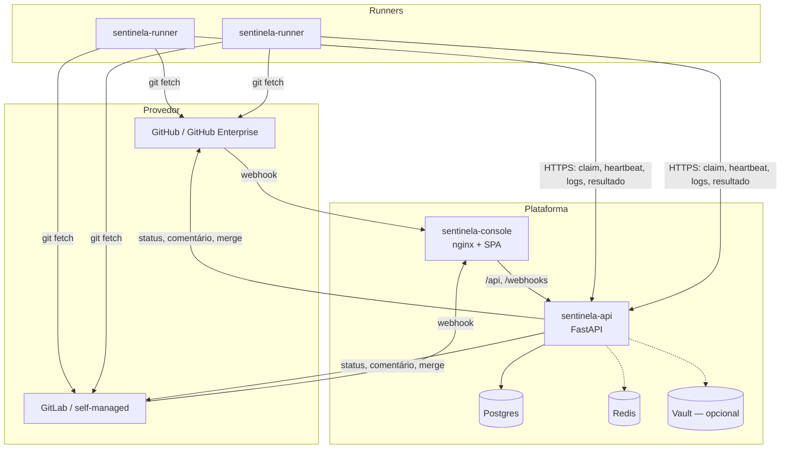
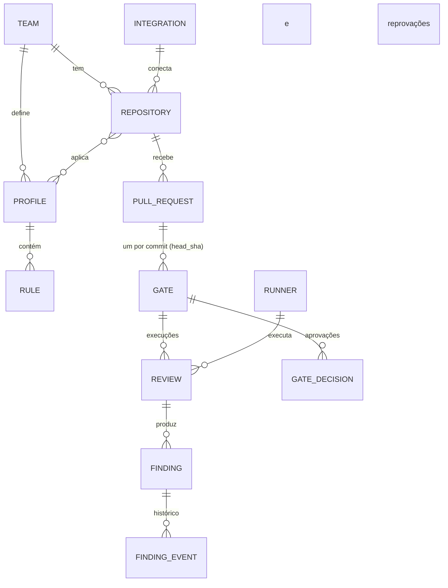
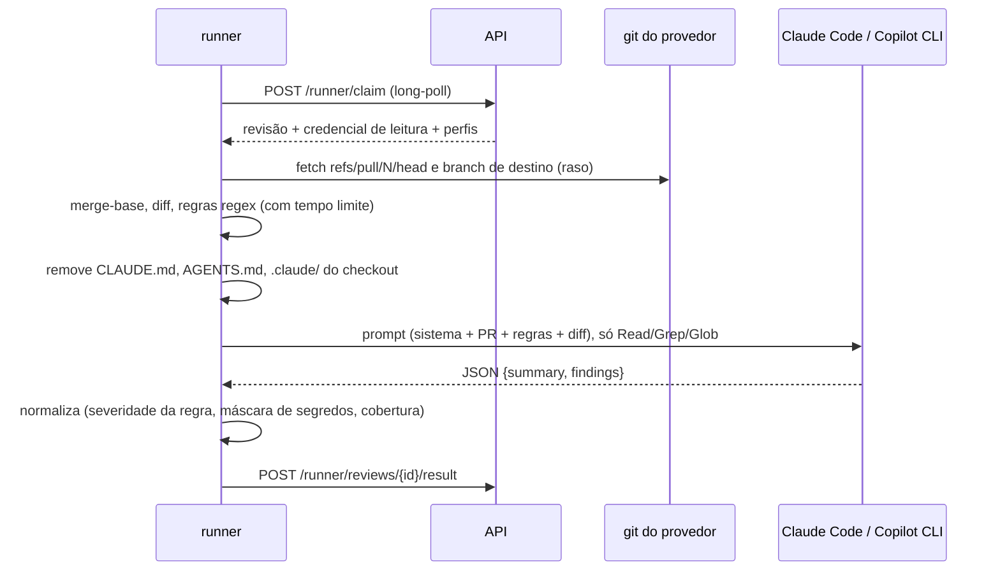

# Arquitetura

## Visão geral



- **API**: stateless. Pode rodar em várias réplicas. O estado fica no Postgres. O Redis só
  distribui eventos de tempo real (SSE) e o buffer de logs ao vivo entre réplicas; sem ele, o
  barramento fica em memória (uma réplica).
- **Runners**: puxam trabalho (long-poll), nunca recebem conexões. Precisam alcançar a API e
  o git do provedor. Podem rodar em VM, container ou num cluster; cada um anuncia as
  ferramentas instaladas (`claude`, `copilot`) e só pega revisões que consegue executar.
- **Console**: SPA servida pelo nginx, que também faz o proxy de `/api` e `/webhooks` para a
  API (com SSE sem buffer).

## Modelo de dados



| Entidade | Papel |
| --- | --- |
| `Team`, `RoleBinding`, `User` | Times, papéis (admin, tech lead, revisor, dev, leitor) por usuário ou grupo do SSO, logins no GitHub/GitLab |
| `Integration` | Conexão com um GitHub ou GitLab: URL, usuário-robô, token e segredo de webhook (no cofre) |
| `Profile`, `Rule` | Padrão de um tipo de implementação e suas regras (IA ou regex) |
| `Repository` | Repositório do time: perfis, branches com gate, modo do gate, política de aprovação |
| `PullRequest` | Projeção do PR/MR (autor, branches, head, estado, merge sem gate) |
| `Gate` | Situação de **um commit**: política congelada no momento do commit, revisão atual, status publicado |
| `Review` | Uma execução da revisão automática (fila, lease, runner, motor, modelo, estatísticas) |
| `Finding`, `FindingEvent` | Apontamento e o que aconteceu com ele (exceção, falso positivo, contestação, comentário) |
| `GateDecision` | Aprovação ou reprovação de uma pessoa |
| `AuditLog` | Toda escrita, com antes e depois |

A política do gate (`approval_mode`, severidades, aprovações mínimas, herança de
justificativas) é **copiada para o gate** quando o commit chega. Mudar a política do
repositório vale para os próximos commits; reexecutar a revisão de um commit não troca a
política dele.

## Regra do gate

A regra fica em [`sentinela_core/gate.py`](../sentinela-core/src/sentinela_core/gate.py):

1. Merge feito, substituído por commit novo ou liberado em emergência: situação final.
2. Revisão em fila/execução: **em revisão**. Revisão falhou: **erro** (reexecutar).
3. Alguma reprovação vigente: **reprovado**.
4. Apontamento em aberto ou contestado com severidade ≥ `block_severity`: **bloqueado**.
5. Nenhum apontamento que exija humano (`requires_human`): **aprovado pela IA**.
6. Aprovações ≥ mínimo: **aprovado**. Senão: **aguardando aprovação**.

Detalhes que fecham brechas:

- **Aprovação vale para a revisão atual; reprovação vale para o commit.** Reexecutar a
  revisão invalida aprovações, mas não apaga um "não". Só quem reprovou muda o voto.
- **Exigência de humano é pegajosa por commit.** Se alguma revisão do commit teve
  apontamento, reexecutar até sair "limpo" não devolve a decisão à IA.
- **Autor nunca decide.** Aprovar, reprovar, aceitar exceção e marcar falso positivo exigem
  autor identificado e login do decisor vinculado no provedor (é o que prova que não é o
  autor).
- **Falso positivo em bloqueante é do tech lead**, como a exceção.
- **Herança por impressão digital** (`regra + arquivo + trecho normalizado`): justificativas
  e falsos positivos passam para os próximos commits do PR, mas só se a ocorrência mais
  recente ainda estiver justificada (reabriu, não volta).

## Fila de revisões

Sem broker: a fila é a tabela `reviews`.

- `enqueue` cria a revisão `queued`, cancela as ativas do mesmo gate e aponta o gate para ela.
- `claim` (long-poll de até 20 s) faz `SELECT … WHERE status='queued' AND engine_kind IN (…)
  ORDER BY created_at FOR UPDATE SKIP LOCKED LIMIT 1`, marca `running` com lease de 120 s e
  devolve o payload (PR, URL de clone, credencial de leitura, perfis congelados, motor, modelo,
  variáveis do motor, valores a mascarar).
- O runner renova a lease no heartbeat e a cada mudança de fase. O heartbeat também devolve
  as revisões que ele deve abandonar (canceladas ou substituídas).
- `result` e `fail` travam a linha da revisão e conferem estado e dono antes de gravar:
  um reenvio depois de timeout, ou uma lease já devolvida à fila, não grava duas vezes.
- O reconciliador devolve à fila as revisões com lease vencida (até 2 tentativas), marca
  runners offline, republica status que falharam e confere se o status no provedor ainda
  é o que o Sentinela publicou (adulteração vira auditoria e é corrigida).

## Runner



Cuidados no runner:

- **Credencial do git só para o host do repositório**: `http.<origem>.extraHeader` em
  variáveis `GIT_CONFIG_*` (fora da linha de comando, mascarado nos logs).
- **IA sem poder de escrita nem execução**. No Claude Code:
  `--tools Read,Grep,Glob --allowedTools Read,Grep,Glob --permission-mode dontAsk`,
  `--strict-mcp-config`, `--disable-slash-commands`, `--no-session-persistence`, saída com
  `--json-schema` e `--restricted` (ou `--bare`). Na Copilot CLI:
  `--allow-tool read --deny-tool shell --deny-tool write`, `--disable-builtin-mcps`,
  `--no-custom-instructions`.
- **Conteúdo do PR é dado, não instrução**: o prompt diz isso explicitamente; arquivos de
  instrução de agentes são removidos do checkout antes da IA rodar (continuam no diff).
- **Resposta fora do formato falha a revisão** em vez de virar "nenhum apontamento".
- **Segredos mascarados** nos logs e no trecho de evidência dos achados.
- **Subprocessos com tempo limite e cancelamento** (o grupo inteiro recebe SIGTERM e depois
  SIGKILL).

## Tempo real

Eventos (`pull_request`, `review`, `gate`, `finding`) são publicados no canal do time; o
console mantém um SSE em `/api/v1/teams/{time}/events` e invalida as consultas afetadas. O
log da revisão em andamento tem um SSE próprio com o buffer recente. A conexão com o banco é
devolvida ao pool antes de o stream começar.

## Pastas

```
sentinela-core/      contratos (sem banco, sem rede)
sentinela-api/       API, modelos, migrações, provedores, serviços, rotas
sentinela-runner/    agente, git, motores de IA, execução
sentinela-console/   console (broto-ui em vendor/)
scripts/             GitHub simulado, demonstração, capturas de tela
tests/e2e, tests/ui  ponta a ponta com processos reais e interface com Playwright
examples/perfis/     perfis da biblioteca em YAML
```
